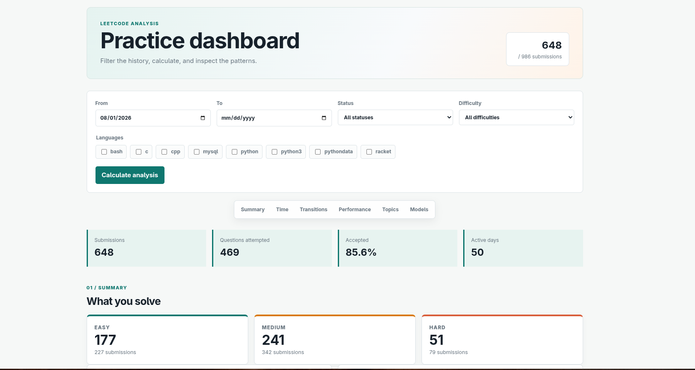
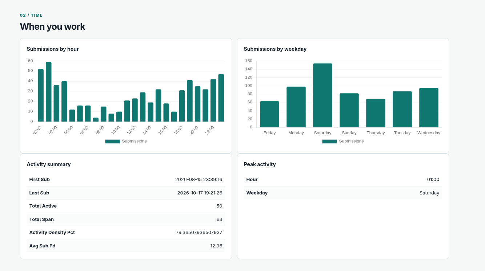

# LEETCODE Visualizer

You can visualize your own behaviours and stats of leetcode here

## How to use

### STEP 1 : Get your Cookies from a logged in browser's network tab and put into `.env`

### STEP 2 : The Data
```bash
    python3 -m venv .venv # for obvious reasons
    python3 scripts/sc1.py  #for your submissions
    python3 scripts/sc2.py  # all questions of leetcode
```

### STEP 3: Once it's lodaded you can run flask app or play with `run.py`
```bash
    python3 app.py # flask app
```


## Preview





## License
GPL-v3


## Author 
Me

## Credits
- My Idea to do such a project
- Medium Articles etc. for the statsitical measures and all
- AI for the frontend (after 4 negotiations and I'm scared to ask for dark mode as it might break something else entirely)